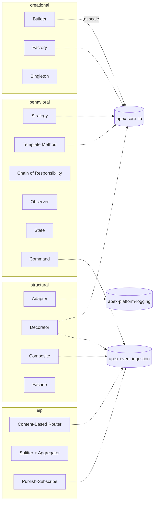

# apex-design-patterns

[](https://github.com/csquaredaz/apex-design-patterns/actions/workflows/ci.yml)


## The problem

Most Apex codebases contain design patterns. Few contain them on purpose. Typical symptoms: a "Singleton" that someone expects to survive across transactions, a Strategy hierarchy around an `if` statement that will never grow, or a Builder wrapped around an SObject that already has named fields. Pattern catalogs written for Java say when to use a pattern, but rarely when _not_ to, and never what governor limits, static transaction scope or the Stub API change. This repo is a catalog of GoF and Enterprise Integration Patterns in Apex. Each pattern solves a small problem in a fictional Orders / Shipments / Customers domain, in about 100 tested lines, with a card that leads with when not to use it. Where a pattern runs at production grade elsewhere in this portfolio, the card links there instead of repeating it. The selection and the "don't" lists are informed by production experience at scale.

## Architecture



Each pattern lives in `force-app/<family>/<pattern>/`, with its code and tests in `classes/` and its card in `README.md` ([ADR 0002](docs/adr/0002-catalog-layout-and-cards.md)). Dotted lines point to the production form in another repo of this portfolio ([ADR 0003](docs/adr/0003-cross-link-instead-of-duplicating.md)).

## Quick start

```bash
npm ci
npm run org:setup
npm run org:test
```

Requires the Salesforce CLI and a Dev Hub set as the default (`sf config set target-dev-hub=<alias>`).

## Usage

Open a pattern's card, read "Don't use it when" first, then the code and its test. The catalog:

| Family     | Pattern                                                                              | The problem it solves here                                      | Status |
| ---------- | ------------------------------------------------------------------------------------ | --------------------------------------------------------------- | ------ |
| creational | [Builder](force-app/creational/builder/README.md)                                    | A valid, immutable shipment request without a 7-arg constructor | Done   |
| creational | [Factory (`Type.forName` + Custom Metadata)](force-app/creational/factory/README.md) | A carrier client chosen by configuration                        | Done   |
| creational | [Singleton (transaction-scoped)](force-app/creational/singleton/README.md)           | Settings loaded once per transaction, and why not "globally"    | Done   |
| structural | [Adapter](force-app/structural/adapter/README.md)                                    | A carrier's tracking payload mapped to our model                | Done   |
| structural | [Decorator](force-app/structural/decorator/README.md)                                | Surcharges stacked on a base shipping cost                      | Done   |
| structural | [Composite](force-app/structural/composite/README.md)                                | Bundles of order lines priced as one                            | Done   |
| structural | [Facade](force-app/structural/facade/README.md)                                      | One checkout call over pricing, stock and booking               | Done   |
| behavioral | Strategy                                                                             | Rate shopping across carriers                                   | PR 3   |
| behavioral | Template Method                                                                      | An order export with fixed steps and variable formatting        | PR 3   |
| behavioral | Chain of Responsibility                                                              | Order checks that can stop the chain                            | PR 3   |
| behavioral | Observer                                                                             | In-transaction listeners on "order shipped"                     | PR 3   |
| behavioral | State                                                                                | A fulfilment lifecycle that rejects illegal transitions         | PR 3   |
| behavioral | Command                                                                              | Queued, undoable shipment operations                            | PR 3   |
| eip        | Content-Based Router                                                                 | Tracking events routed by carrier                               | PR 4   |
| eip        | Splitter + Aggregator                                                                | An order split per warehouse, then reassembled                  | PR 4   |
| eip        | Publish-Subscribe Channel                                                            | `Order_Shipped_Event__e` and a trigger subscriber               | PR 4   |

```apex
ShipmentRequest request = ShipmentRequest.builder()
  .forOrder('ORD-1001')
  .withCarrier('parcelco')
  .weighing(1200)
  .to('SW1A 1AA')
  .build(); // throws InvalidRequestException naming every missing field
```

## Design decisions

| Decision                | Choice                                                      | Rejected alternative                       | ADR                                                        |
| ----------------------- | ----------------------------------------------------------- | ------------------------------------------ | ---------------------------------------------------------- |
| Distribution            | Source only, no package                                     | An unlocked package with no namespace      | [0001](docs/adr/0001-source-only-distribution.md)          |
| Layout                  | `force-app/<family>/<pattern>/` with a card beside the code | Cards in `docs/patterns/`, apart from code | [0002](docs/adr/0002-catalog-layout-and-cards.md)          |
| Overlap with A, B and C | Teaching-size version plus a link; some patterns link-only  | Re-implementing at full size               | [0003](docs/adr/0003-cross-link-instead-of-duplicating.md) |
| Data                    | In memory first; the platform only where it's the point     | Every pattern on standard objects          | [0004](docs/adr/0004-in-memory-first.md)                   |

## Testing

| Layer                          | What it proves                                                     | Run it             |
| ------------------------------ | ------------------------------------------------------------------ | ------------------ |
| Apex unit                      | Each pattern's behaviour, a negative path, and a 200-item case     | `npm run org:test` |
| Apex integration (real events) | Publish-Subscribe as a Minimum Access user with one permission set | `npm run org:test` |
| Static analysis                | Zero High or Critical Code Analyzer findings                       | `npm run analyze`  |

CI runs every layer on each PR in a fresh scratch org, then deletes the org. The running admin has none of this repo's permission sets (`SKIP_PERMSETS=1`), so tests set up their own users' access. Each pattern's card lists what its tests prove.

## Built with Claude Code

- **Standards:** this repo's [`CLAUDE.md`](CLAUDE.md) and the [`apex-standards`](https://github.com/csquaredaz/claude-code-salesforce-skills) plugin (`apex-fflib-layers`, `apex-security`, `apex-testing`, `apex-code-review`). The repo was scaffolded from the plugin's `sf-repo-scaffold` template.
- **One concrete example:** written once the catalog is complete.
- **How AI work is reviewed:** every AI-assisted commit carries a `Co-Authored-By: Claude` trailer, goes through a PR with CI, and is reviewed against the same standards.

## License

MIT
