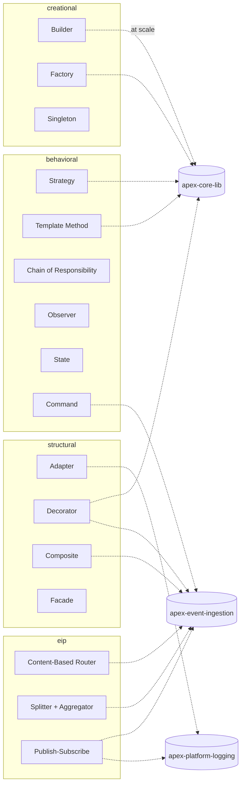

# apex-design-patterns

[](https://github.com/csquaredaz/apex-design-patterns/actions/workflows/ci.yml)


## The problem

Most Apex codebases contain design patterns. Few contain them on purpose. Typical symptoms: a "Singleton" that someone expects to survive across transactions, a Strategy hierarchy around an `if` statement that will never grow, or a Builder wrapped around an SObject that already has named fields. Pattern catalogs written for Java say when to use a pattern, but rarely when _not_ to, and never what governor limits, static transaction scope or the Stub API change. This repo is a catalog of GoF and Enterprise Integration Patterns in Apex. Each pattern solves a small problem in a fictional Orders / Shipments / Customers domain, in about 100 tested lines, with a card that leads with when not to use it. Where a pattern runs at production grade elsewhere in this portfolio, the card links there instead of repeating it. The selection and the "don't" lists are informed by production experience at scale.

## Architecture



Each pattern lives in `force-app/<family>/<pattern>/`, with its code and tests in `classes/` and its card in `README.md` ([ADR 0002](docs/adr/0002-catalog-layout-and-cards.md)). Dotted lines point to the production form in another repo of this portfolio ([ADR 0003](docs/adr/0003-cross-link-instead-of-duplicating.md)).

## Quick start

```bash
npm ci
npm run org:setup
npm run org:test
```

Requires the Salesforce CLI and a Dev Hub set as the default (`sf config set target-dev-hub=<alias>`).

## Usage

Open a pattern's card, read "Don't use it when" first, then the code and its test. The catalog:

| Family     | Pattern                                                                              | The problem it solves here                                      | Status |
| ---------- | ------------------------------------------------------------------------------------ | --------------------------------------------------------------- | ------ |
| creational | [Builder](force-app/creational/builder/README.md)                                    | A valid, immutable shipment request without a 7-arg constructor | Done   |
| creational | [Factory (`Type.forName` + Custom Metadata)](force-app/creational/factory/README.md) | A carrier client chosen by configuration                        | Done   |
| creational | [Singleton (transaction-scoped)](force-app/creational/singleton/README.md)           | Settings loaded once per transaction, and why not "globally"    | Done   |
| structural | [Adapter](force-app/structural/adapter/README.md)                                    | A carrier's tracking payload mapped to our model                | Done   |
| structural | [Decorator](force-app/structural/decorator/README.md)                                | Surcharges stacked on a base shipping cost                      | Done   |
| structural | [Composite](force-app/structural/composite/README.md)                                | Bundles of order lines priced as one                            | Done   |
| structural | [Facade](force-app/structural/facade/README.md)                                      | One checkout call over pricing, stock and booking               | Done   |
| behavioral | [Strategy](force-app/behavioral/strategy/README.md)                                  | Rate shopping across carriers                                   | Done   |
| behavioral | [Template Method](force-app/behavioral/template-method/README.md)                    | An order export with fixed steps and variable formatting        | Done   |
| behavioral | [Chain of Responsibility](force-app/behavioral/chain-of-responsibility/README.md)    | Order checks that can stop the chain                            | Done   |
| behavioral | [Observer](force-app/behavioral/observer/README.md)                                  | In-transaction listeners on "order shipped"                     | Done   |
| behavioral | [State](force-app/behavioral/state/README.md)                                        | A fulfilment lifecycle that rejects illegal transitions         | Done   |
| behavioral | [Command](force-app/behavioral/command/README.md)                                    | Queued, undoable shipment operations                            | Done   |
| eip        | [Content-Based Router](force-app/eip/content-based-router/README.md)                 | Tracking scans routed by carrier                                | Done   |
| eip        | [Splitter + Aggregator](force-app/eip/splitter-aggregator/README.md)                 | An order split per warehouse, then reassembled                  | Done   |
| eip        | [Publish-Subscribe Channel](force-app/eip/publish-subscribe/README.md)               | `Order_Shipped_Event__e` and a trigger subscriber               | Done   |

```apex
ShipmentRequest request = ShipmentRequest.builder()
  .forOrder('ORD-1001')
  .withCarrier('parcelco')
  .weighing(1200)
  .to('SW1A 1AA')
  .build(); // throws InvalidRequestException naming every missing field
```

### Patterns that live elsewhere in this portfolio

A faithful version of these needs a custom object, files or permission sets, which would copy `apex-event-ingestion` ([ADR 0003](docs/adr/0003-cross-link-instead-of-duplicating.md)). Each row links to the production form and the decision behind it.

| Family | Pattern                                                 | Where it runs                                                                                                                                                                                                                                                                                                                                                    | Decision                                                                                                               |
| ------ | ------------------------------------------------------- | ---------------------------------------------------------------------------------------------------------------------------------------------------------------------------------------------------------------------------------------------------------------------------------------------------------------------------------------------------------------- | ---------------------------------------------------------------------------------------------------------------------- |
| eip    | Idempotent Receiver                                     | `apex-event-ingestion`: a unique, case-sensitive key on the producer's message Id, and a partial-success insert                                                                                                                                                                                                                                                  | [ADR 0003](https://github.com/csquaredaz/apex-event-ingestion/blob/main/docs/adr/0003-producer-idempotency-key.md)     |
| eip    | Claim Check                                             | `apex-event-ingestion`: large payloads as a producer-uploaded `ContentVersion`, with the uploader verified                                                                                                                                                                                                                                                       | [ADR 0008](https://github.com/csquaredaz/apex-event-ingestion/blob/main/docs/adr/0008-claim-check.md)                  |
| eip    | Dead Letter Channel                                     | `apex-event-ingestion`: messages that keep failing are marked `Dead`, recovered from a Queueable Finalizer                                                                                                                                                                                                                                                       | [ADR 0006](https://github.com/csquaredaz/apex-event-ingestion/blob/main/docs/adr/0006-queueable-finalizer-recovery.md) |
| eip    | Message Store                                           | `apex-event-ingestion`: every inbound message in `Inbound_Message__c`, with status and attempts                                                                                                                                                                                                                                                                  | [ADR 0002](https://github.com/csquaredaz/apex-event-ingestion/blob/main/docs/adr/0002-message-store.md)                |
| PoEAA  | Unit of Work, Query Object, Service Layer, DI container | `apex-core-lib`: [`UnitOfWork`](https://github.com/csquaredaz/apex-core-lib/blob/main/force-app/data/classes/UnitOfWork.cls), [`SObjectSelector`](https://github.com/csquaredaz/apex-core-lib/blob/main/force-app/data/classes/SObjectSelector.cls), [`Application`](https://github.com/csquaredaz/apex-core-lib/blob/main/force-app/di/classes/Application.cls) | [ADR 0002](https://github.com/csquaredaz/apex-core-lib/blob/main/docs/adr/0002-lean-fflib-core.md)                     |

### Deliberately left out

| Pattern     | Why it isn't here                                                                                                                                                  |
| ----------- | ------------------------------------------------------------------------------------------------------------------------------------------------------------------ |
| Prototype   | Apex has `clone()` on SObjects and collections (`deepClone()` for lists of SObjects). A Prototype hierarchy adds nothing.                                          |
| Flyweight   | Apex objects live for one transaction, and heap is per transaction. There's no long-lived pool of shared objects to save memory with.                              |
| Iterator    | `Iterable<T>` and `Iterator<T>` are built into the language, and `for` loops use them. Writing one is rare: a custom `Database.Batchable` scope is the usual case. |
| Visitor     | Double dispatch over a fixed class hierarchy rarely fits Apex code, where types are SObjects and DTOs. A `switch on` over the type is clearer at catalog size.     |
| Interpreter | A grammar and parser are almost never the right answer on the platform. Formula fields, Flow and validation rules already give admins an expression language.      |
| Mediator    | On Salesforce this role is played by a service layer or by Platform Events. Both are covered: see Facade and Publish-Subscribe.                                    |
| Memento     | Saving and restoring object state is what `Database.setSavepoint()` and `rollback()` do for data. In-memory undo appears in Command instead.                       |

## Design decisions

| Decision                | Choice                                                      | Rejected alternative                       | ADR                                                        |
| ----------------------- | ----------------------------------------------------------- | ------------------------------------------ | ---------------------------------------------------------- |
| Distribution            | Source only, no package                                     | An unlocked package with no namespace      | [0001](docs/adr/0001-source-only-distribution.md)          |
| Layout                  | `force-app/<family>/<pattern>/` with a card beside the code | Cards in `docs/patterns/`, apart from code | [0002](docs/adr/0002-catalog-layout-and-cards.md)          |
| Overlap with A, B and C | Teaching-size version plus a link; some patterns link-only  | Re-implementing at full size               | [0003](docs/adr/0003-cross-link-instead-of-duplicating.md) |
| Data                    | In memory first; the platform only where it's the point     | Every pattern on standard objects          | [0004](docs/adr/0004-in-memory-first.md)                   |

## Testing

| Layer                          | What it proves                                                     | Run it             |
| ------------------------------ | ------------------------------------------------------------------ | ------------------ |
| Apex unit                      | Each pattern's behaviour, a negative path, and a 200-item case     | `npm run org:test` |
| Apex integration (real events) | Publish-Subscribe as a Minimum Access user with one permission set | `npm run org:test` |
| Static analysis                | Zero High or Critical Code Analyzer findings                       | `npm run analyze`  |

CI runs every layer on each PR in a fresh scratch org, then deletes the org. The running admin has none of this repo's permission sets (`SKIP_PERMSETS=1`), so tests set up their own users' access. Each pattern's card lists what its tests prove.

## Built with Claude Code

- **Standards:** this repo's [`CLAUDE.md`](CLAUDE.md) and the [`apex-standards`](https://github.com/csquaredaz/claude-code-salesforce-skills) plugin (`apex-fflib-layers`, `apex-security`, `apex-testing`, `apex-code-review`). The repo was scaffolded from the plugin's `sf-repo-scaffold` template.
- **One concrete example:** Claude Code drafted the configuration-driven Factory, and its own review against `apex-code-review` caught a real defect before the PR opened. `CarrierClientFactory` called `Type.newInstance()` before checking that the class implemented `ICarrierClient`, so a Custom Metadata row naming the wrong class would run that class's constructor (and any side effects in it) before failing. The fix checks `ICarrierClient.class.isAssignableFrom(type)` first, a test proves a row naming the wrong class fails with a message that names the carrier and the class, and the factory card explains the ordering. Later, the Publish-Subscribe tests caught Claude's own assumption that a Task on a deleted Order would fail to insert: it doesn't, so the test and card now use an Order Id that never existed.
- **Platform claims are probed, not assumed:** before the Publish-Subscribe subscriber was written, a probe in a scratch org proved that the Automated Process user can insert Tasks on Orders in user mode with no permission set. The card cites it.
- **How AI work is reviewed:** every AI-assisted commit carries a `Co-Authored-By: Claude` trailer, goes through a PR with CI, and is reviewed against the same standards.

## License

MIT
