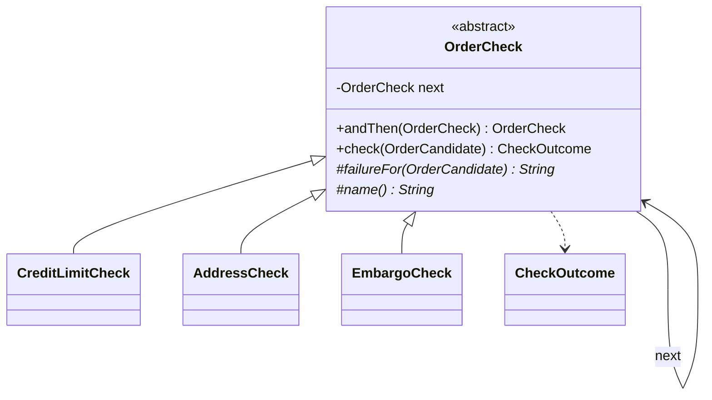

# Chain of Responsibility

**Intent:** pass a request along a chain of handlers, each of which can deal with it or hand it on, so the sender doesn't know which handler will act.

## The problem here

Before an order is accepted it must pass a credit limit, have a deliverable address and not go to an embargoed country. One `validate()` method with every rule grows into a wall of `if`s that nobody dares reorder. Here, each rule is an `OrderCheck` link. A link either rejects the order, which ends the chain and names the failed check, or passes it on. Callers hold the first link only.

## Shape in Apex



```apex
OrderCheck checks = new CreditLimitCheck(1000);
checks.andThen(new AddressCheck()).andThen(new EmbargoCheck(new Set<String>{ 'XX' }));
CheckOutcome outcome = checks.check(candidate); // outcome.failedCheck = 'Credit limit', for example
```

Code: [`OrderCheck.cls`](classes/OrderCheck.cls), [`CreditLimitCheck.cls`](classes/CreditLimitCheck.cls), [`AddressCheck.cls`](classes/AddressCheck.cls), [`EmbargoCheck.cls`](classes/EmbargoCheck.cls), [`CheckOutcome.cls`](classes/CheckOutcome.cls), [`OrderCandidate.cls`](classes/OrderCandidate.cls) · Tests: [`OrderCheckTest.cls`](classes/OrderCheckTest.cls)

## Use it when

- A request passes through independent rules, and the first one that objects decides.
- Rules are added, removed or reordered more often than the code that runs them changes.
- A cheap rule should run before an expensive one, such as an address format check before a credit callout.

## Don't use it when

- **Every rule must run and every failure must be reported,** as on a form that lists all errors. That's a list of validators that collect results, not a chain that stops.
- **There's one rule.** A chain of one is a method with extra steps.
- **The rules are record-level and declarative.** Validation rules, or a before-save Flow, are visible to admins and need no code. Use a chain when the rules need Apex: callouts, cross-object logic, or ordering that matters.

## Salesforce specifics

- **`then` is a reserved word in Apex,** so links join with `andThen`. It returns the _next_ link, so a chain reads left to right, but you must keep a reference to the first link.
- **Order is behaviour.** When an order breaks several rules, the first link decides which failure the user sees (`check_linkOrder_decidesWhichFailureIsReported`). Put cheap, local checks before callouts, because a callout check that fails late has already spent the callout.
- **Bulk callers run the chain per record:** 200 orders mean 200 walks of the chain. That's fine for in-memory rules; a rule that queries must not query per record. Load what it needs once for the batch and pass it in.
- **A link can't link to itself,** which `andThen` rejects; a longer cycle would recurse until the stack overflows.

## See it at scale

None of the other repos in this portfolio uses a chain. The nearest relative is `apex-core-lib`'s [`TriggerDispatcher`](https://github.com/csquaredaz/apex-core-lib/blob/main/force-app/triggers/classes/TriggerDispatcher.cls), which picks the one domain that handles a trigger event: a dispatcher picks one handler up front, where a chain asks each link in turn.

## What the tests prove

| Test                                            | Proves                                                                 |
| ----------------------------------------------- | ---------------------------------------------------------------------- |
| `check_validOrder_passesEveryLink`              | A valid order passes, with no failed check named                       |
| `check_eachRuleBroken_namesTheFailingCheck`     | Each rule reports itself and a reason; embargo codes match in any case |
| `check_earlyFailure_laterLinksNeverRun`         | After a failure, later links never run; after a pass, they do          |
| `check_linkOrder_decidesWhichFailureIsReported` | Reordering links changes which failure is reported                     |
| `andThen_nullOrSelf_rejected`                   | A link can't point to null or to itself                                |
| `check_twoHundredOrders_eachJudgedAlone`        | 200 orders through one chain give 101 passes, exactly at the limit     |
