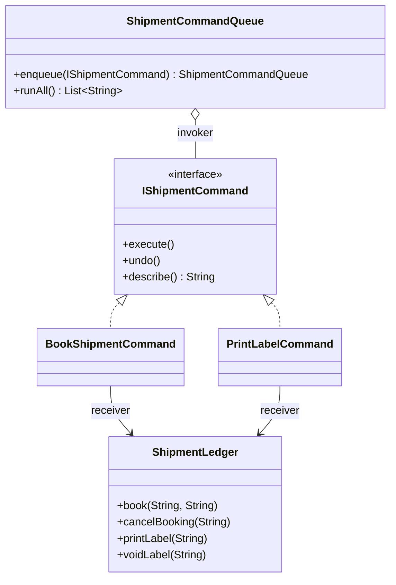

# Command

**Intent:** turn a request into an object, so it can be queued, logged, run later and undone.

## The problem here

Dispatching an order books a shipment, then prints its label. If the label fails, the booking must be cancelled, or the carrier collects a parcel nobody packed. Writing that rollback by hand in every dispatch path is error-prone. Here, each step is an `IShipmentCommand` with `execute()` and `undo()`, and `ShipmentCommandQueue.runAll()` runs them in order. If one fails, the queue undoes the ones that ran, newest first, and reports which command failed.

## Shape in Apex



```apex
new ShipmentCommandQueue()
  .enqueue(new BookShipmentCommand(ledger, 'ORD-1', 'PARCELCO'))
  .enqueue(new PrintLabelCommand(ledger, 'ORD-1'))
  .runAll(); // a failing label undoes the booking, then throws CommandFailedException
```

Code: [`IShipmentCommand.cls`](classes/IShipmentCommand.cls), [`ShipmentCommandQueue.cls`](classes/ShipmentCommandQueue.cls), [`BookShipmentCommand.cls`](classes/BookShipmentCommand.cls), [`PrintLabelCommand.cls`](classes/PrintLabelCommand.cls), [`ShipmentLedger.cls`](classes/ShipmentLedger.cls) · Tests: [`ShipmentCommandQueueTest.cls`](classes/ShipmentCommandQueueTest.cls)

## Use it when

- Operations must be queued, retried, logged or undone as units.
- The code that decides _what_ to do is separate from the code that decides _when_ (a dispatcher, a scheduler, a message router).
- Each operation has a clean inverse, so a failed batch can be compensated.

## Don't use it when

- **Every step writes records in one transaction.** A savepoint and `Database.rollback` undo DML for free; hand-written `undo()` methods are only worth it for work a rollback can't reverse, such as an external booking.
- **The undo isn't really an undo.** A cancellation after a callout is a new request that can itself fail. Treat it as compensation, log it, and make it idempotent.
- **There's one operation, run once.** Call the method.

## Salesforce specifics

- **`Queueable` is the platform's Command:** a serialisable object with an `execute` method, run later by the platform. It has no undo, and its failure recovery is a `Finalizer` (see `apex-event-ingestion`).
- **Undo newest first.** The label depends on the booking, so the label is voided before the booking is cancelled (the mutation check reversed this order, and a test failed).
- **Keep the cause, and survive a failing undo.** `CommandFailedException` wraps the original exception (`getCause()`). Each undo runs in its own `try`, so one undo that fails (a carrier refusing a cancellation) doesn't stop the others or hide the original failure; the message lists it.
- **Catching `Exception` is deliberate here:** the queue must undo whatever went wrong, then rethrow. It never swallows the failure.
- **Callouts and DML:** a command that calls out can't run after another command's uncommitted DML in the same transaction. Order the queue callouts first, or give each command its own Queueable.

## See it at scale

`apex-event-ingestion` dispatches each stored message to `IMessageHandler` commands found by route ([ADR 0004](https://github.com/csquaredaz/apex-event-ingestion/blob/main/docs/adr/0004-command-composite-dispatch.md), [`MessageDispatcher`](https://github.com/csquaredaz/apex-event-ingestion/blob/main/force-app/dispatch/classes/MessageDispatcher.cls)), with retries and a dead-letter status instead of undo.

## What the tests prove

| Test                                                     | Proves                                                                                               |
| -------------------------------------------------------- | ---------------------------------------------------------------------------------------------------- |
| `runAll_bookThenLabel_bothApplied`                       | Commands run in order and report what ran                                                            |
| `runAll_commandFails_earlierOnesUndoneNewestFirst`       | A failure undoes earlier commands newest first, keeps the cause and leaves nothing behind            |
| `runAll_undoAlsoFails_otherUndosStillRunAndBothReported` | A failing undo doesn't stop the other undos, and both failures are reported                          |
| `runAll_queueEmptiedAfterRun_secondRunDoesNothing`       | Each command runs once                                                                               |
| `commands_createdButNotRun_changeNothing`                | Creating a command does nothing; undo reverses execute; double booking and null commands are refused |
| `runAll_twoHundredOrders_allBookedAndLabelled`           | 400 commands for 200 orders all run                                                                  |
