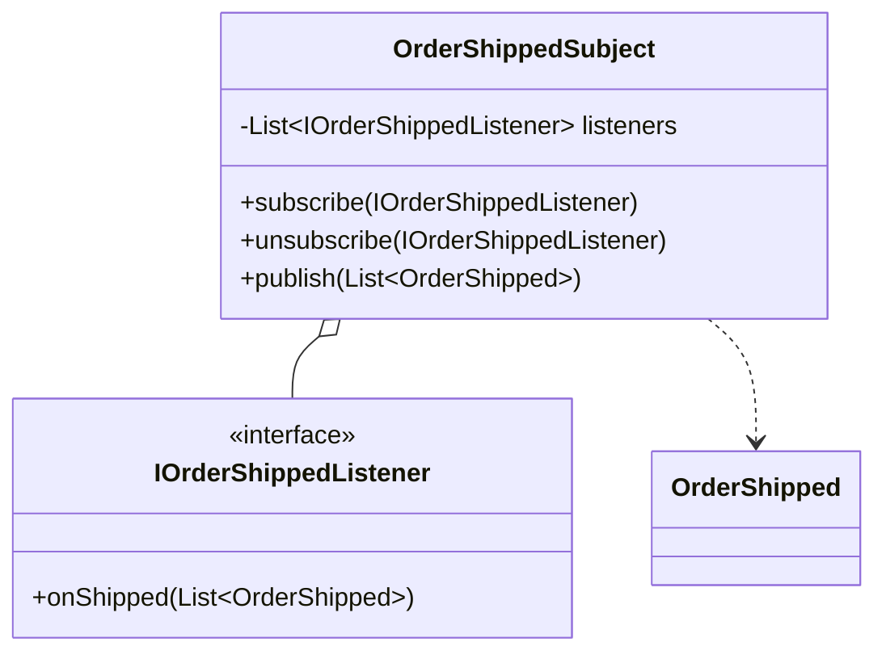

# Observer (in-transaction)

**Intent:** let objects subscribe to events from a subject, so the subject notifies them without knowing who they are.

## The problem here

When orders ship, a customer notifier, a loyalty-points service and an analytics feed all need to know. If the shipping code calls each one, every new consumer means editing shipping. Here, shipping calls `OrderShippedSubject.publish()`, and consumers subscribe. Each listener gets the whole batch in one call: on Salesforce, a listener that queries or writes must do it once per batch, not once per order.

## Shape in Apex



```apex
OrderShippedSubject subject = new OrderShippedSubject();
subject.subscribe(new CustomerNotifier());
subject.subscribe(new LoyaltyPoints());
subject.publish(shippedOrders); // each listener once, with all of them
```

Code: [`OrderShippedSubject.cls`](classes/OrderShippedSubject.cls), [`IOrderShippedListener.cls`](classes/IOrderShippedListener.cls), [`OrderShipped.cls`](classes/OrderShipped.cls) · Tests: [`OrderShippedSubjectTest.cls`](classes/OrderShippedSubjectTest.cls)

## Use it when

- One event has several independent consumers, and the producer shouldn't know them.
- The consumers must succeed or fail with the producer, in the same transaction, for example a points balance that must never disagree with a shipment.

## Don't use it when

- **A consumer's failure must not undo the producer's work.** In-transaction listeners share one transaction: if the analytics feed throws, the shipment rolls back too, and the listeners after it never run (`publish_listenerThrows_laterListenersSkippedAndCallerSeesIt`). Publish a Platform Event instead (`eip/publish-subscribe`): each subscriber then runs in its own transaction, with its own retries.
- **A consumer is slow or makes callouts.** It holds the caller's transaction and limits. Use a Platform Event or a Queueable.
- **There's exactly one consumer, and always will be.** Call it directly; an Observer adds indirection that makes the call harder to follow.
- **Consumers are admins' Flows.** A record-triggered Flow, or a Platform Event-triggered Flow, already lets admins subscribe without code.

## Salesforce specifics

- **Bulk listeners.** `onShipped(List<OrderShipped>)` is the Salesforce-specific part. A per-event `onShipped(OrderShipped)` invites a query per event in every listener.
- **Identity, not equality.** Listeners are compared with `===`, so two listeners of the same class are two subscribers, and subscribing the same instance twice adds it once.
- **Iterate over a copy** of the listener list, so a listener that unsubscribes itself doesn't make the loop skip its neighbour.
- **Subscriptions are per transaction.** Wire listeners where the subject is created (for example in a service's constructor). To let configuration add listeners, combine this with the configuration-driven Factory (`creational/factory`).

## See it at scale

Across transactions, this pattern becomes Publish-Subscribe with Platform Events: `apex-platform-logging` publishes log events that its subscriber persists, and `apex-event-ingestion` takes producers' messages through a Platform Event intake ([ADR 0007](https://github.com/csquaredaz/apex-event-ingestion/blob/main/docs/adr/0007-platform-event-intake.md)).

## What the tests prove

| Test                                                          | Proves                                                                 |
| ------------------------------------------------------------- | ---------------------------------------------------------------------- |
| `publish_twoHundredOrders_eachListenerCalledOnceInOrder`      | Listeners run in subscribe order, once per batch of 200                |
| `subscribe_twiceOrUnsubscribed_handledByIdentity`             | No duplicates, look-alikes count separately, unsubscribed hear nothing |
| `publish_listenerThrows_laterListenersSkippedAndCallerSeesIt` | One listener's failure stops the rest and reaches the caller           |
| `publish_nothingOrNoListeners_isANoOp`                        | Empty or null batches notify nobody; null listeners are rejected       |
