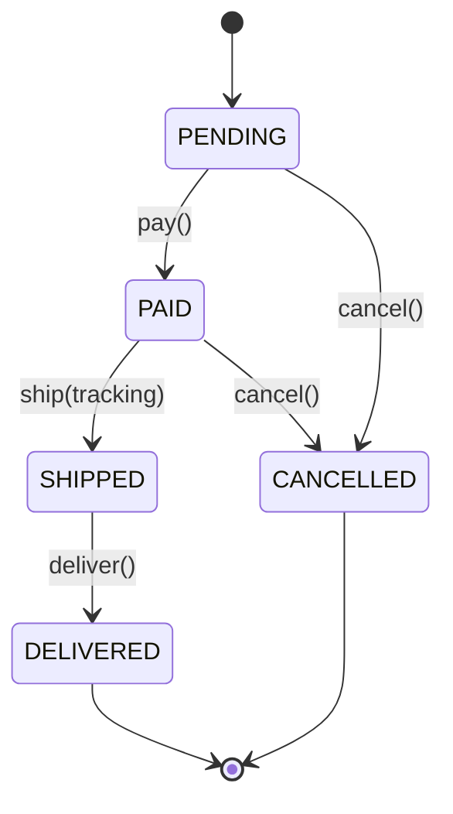
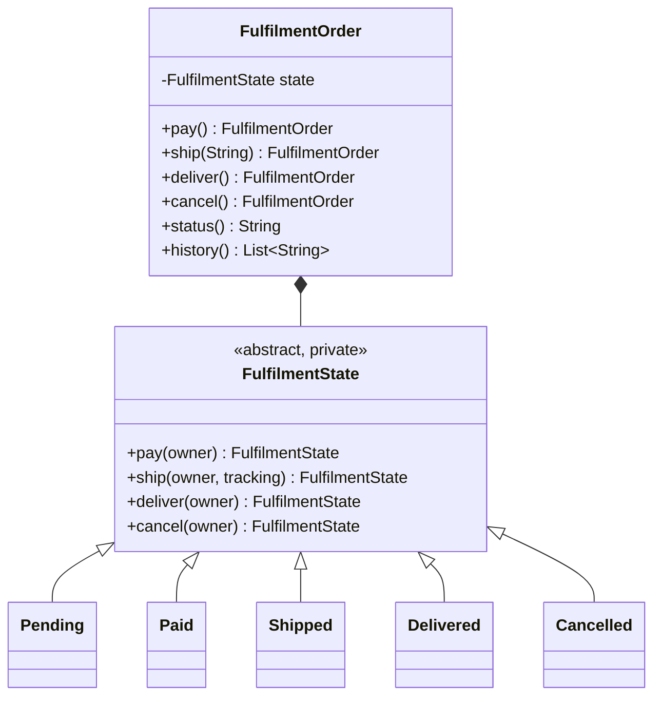

# State

**Intent:** let an object change its behaviour when its internal state changes, by giving each state its own class.

## The problem here

An order's fulfilment status goes PENDING → PAID → SHIPPED → DELIVERED, and can be CANCELLED from PENDING or PAID. In many orgs, those rules are scattered across validation rules, triggers, Flows and services, each checking `if (status == 'PAID')`. Sooner or later one path lets a delivered order be cancelled. Here, each status is a private class that knows its legal moves; any other move throws `IllegalTransitionException` and leaves the order unchanged.

## Shape in Apex





```apex
FulfilmentOrder fulfilment = new FulfilmentOrder('ORD-1').pay().ship('TRK-9');
fulfilment.cancel(); // IllegalTransitionException: Cannot cancel an order that is SHIPPED
```

Code: [`FulfilmentOrder.cls`](classes/FulfilmentOrder.cls) · Tests: [`FulfilmentOrderTest.cls`](classes/FulfilmentOrderTest.cls)

## Use it when

- An object's allowed actions depend on its status, and the rules are more than a couple of `if`s.
- Illegal transitions must be impossible, not just discouraged, wherever the change comes from.
- New statuses are likely. Adding one means a new state class, not edits to every `if`.

## Don't use it when

- **The lifecycle is a straight line with no rules.** A picklist and a validation rule are clearer, and admins can see them.
- **Admins own the process.** If business users change the lifecycle, a declarative model (a picklist with dependent rules, a Flow, or Order's own activation rules) is maintainable by them; a State class needs a developer.
- **The status lives only on the record.** This class enforces transitions when code goes through it. A user editing the picklist directly bypasses it, so pair it with a validation rule, or restrict the field's FLS so only the service can write it.

## Salesforce specifics

- **The states are private inner classes,** so no caller can construct a state or set a status directly; Apex allows one level of inner classes, which is all this needs.
- **An abstract base rejects every move by default,** and each state overrides only its legal ones. The rules for a status sit in one place, and a missing override fails safe.
- **Abstract, virtual and override methods need an explicit access modifier** in Apex, even in a private inner class. They're `public`, which is harmless because the classes are private.
- **Persisting it:** store `status()` in a restricted picklist and rebuild the state from it on load. Write the field only through this class, and back it with a validation rule for edits made outside Apex.
- **`order` would shadow the `Order` SObject** as a parameter name, so states receive their context as `owner`.

## See it at scale

`apex-event-ingestion` keeps its message status rules (Received → Processed, or Failed → retried → Dead) in one service, [`MessageLifecycle`](https://github.com/csquaredaz/apex-event-ingestion/blob/main/force-app/processing/classes/MessageLifecycle.cls) ([ADR 0006](https://github.com/csquaredaz/apex-event-ingestion/blob/main/docs/adr/0006-queueable-finalizer-recovery.md)). It's a status table in a stateless service rather than State objects: the right call when the only behaviour that varies by status is the next status.

## What the tests prove

| Test                                              | Proves                                                                                              |
| ------------------------------------------------- | --------------------------------------------------------------------------------------------------- |
| `lifecycle_happyPath_recordsEveryStatus`          | The full path works, records each status and keeps the tracking number                              |
| `everyStatusAndAction_onlyTheLegalMovesSucceed`   | All 20 status-and-action pairs: only the 5 legal moves succeed, and a rejected move changes nothing |
| `ship_withoutTrackingNumber_rejectedAndStaysPaid` | Shipping needs a tracking number; a refused ship stays PAID                                         |
| `history_returnsACopy`                            | Callers can't rewrite the history                                                                   |
| `twoHundredOrders_eachHasItsOwnState`             | 200 orders keep independent states                                                                  |
