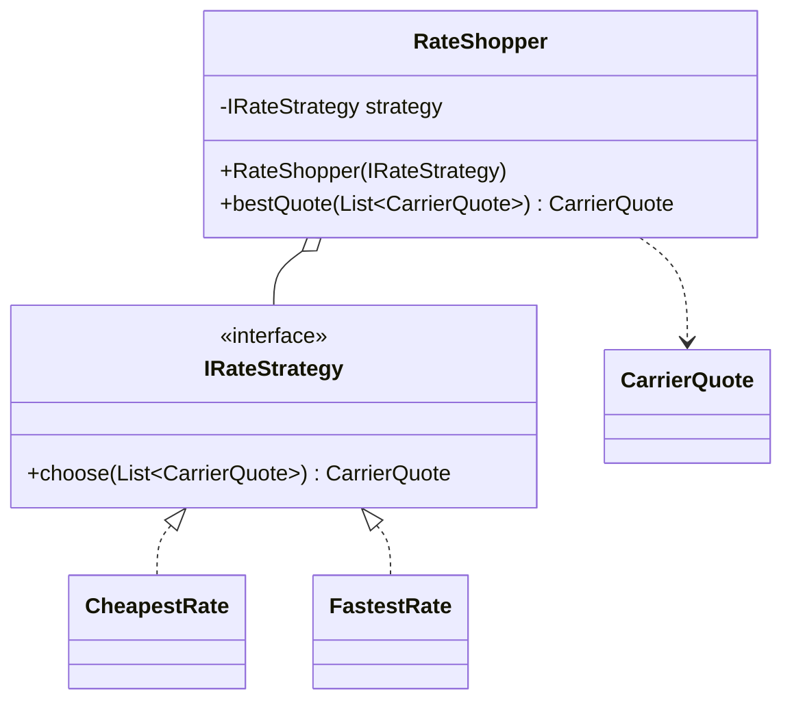

# Strategy

**Intent:** put each variant of an algorithm behind one interface, so the caller picks a variant and the code that uses it stays the same.

## The problem here

Three carriers quote for a shipment. Standard orders should go with the cheapest quote, express orders with the fastest, and a key account always uses its preferred carrier. Without Strategy, `RateShopper` grows a `switch` on the order type that changes every time sales invents a rule. With it, `RateShopper` takes an `IRateStrategy`, and each rule is a small class that can be tested on its own.

## Shape in Apex



```apex
IRateStrategy rule = order.isExpress ? (IRateStrategy) new FastestRate() : new CheapestRate();
CarrierQuote winner = new RateShopper(rule).bestQuote(quotes);
```

Code: [`IRateStrategy.cls`](classes/IRateStrategy.cls), [`CheapestRate.cls`](classes/CheapestRate.cls), [`FastestRate.cls`](classes/FastestRate.cls), [`RateShopper.cls`](classes/RateShopper.cls), [`CarrierQuote.cls`](classes/CarrierQuote.cls) · Tests: [`RateShopperTest.cls`](classes/RateShopperTest.cls)

## Use it when

- Several interchangeable rules answer the same question (pricing, routing, retry timing, scoring).
- The rules change on a different schedule from the code that uses them.
- You want each rule tested on its own, with no setup for the others.

## Don't use it when

- **There are two rules and that won't change.** A ternary or `if` is shorter and just as testable. A Strategy hierarchy around a branch that never grows is the most common over-design in Apex.
- **The rules need different inputs.** If the fastest rule needs the delivery date and the cheapest needs the customer's contract, a shared interface forces every rule to accept everything. Split the question instead.
- **Admins should choose the rule.** Strategy chosen in code needs a deploy to change. To let configuration pick the class, combine it with a configuration-driven Factory (`creational/factory`).

## Salesforce specifics

- **`(IRateStrategy) new FastestRate()`:** Apex's ternary needs both branches to have the same type, so cast one branch to the interface.
- **Ties must be deterministic.** Carriers answer callouts in any order, and Apex `List` order is your input order. Each rule here breaks ties on a second key, then on the carrier code, so retries and tests give the same answer (`bestQuote_orderOfQuotes_doesNotMatter`).
- **`select` is a reserved word in Apex** (SOQL), so the context's method is `bestQuote`.
- **Strategies are cheap to test with no mocks:** they're pure functions of their input. Mock the strategy only when testing the context.

## See it at scale

`apex-core-lib`'s [`RetryPolicy`](https://github.com/csquaredaz/apex-core-lib/blob/main/force-app/callout/classes/RetryPolicy.cls) is the callout client's retry Strategy, and its `IDml` strategies choose user-mode, stripped or system-mode DML for the Unit of Work.

## What the tests prove

| Test                                                | Proves                                                                           |
| --------------------------------------------------- | -------------------------------------------------------------------------------- |
| `bestQuote_strategyChanged_answerChanges`           | The same shopper gives a different answer per strategy, including a caller's own |
| `cheapest_tiedOnPrice_fasterThenAlphabeticalWins`   | Cheapest breaks ties on transit days, then carrier code                          |
| `fastest_tiedOnTransit_cheaperThenAlphabeticalWins` | Fastest breaks ties on price, then carrier code                                  |
| `bestQuote_orderOfQuotes_doesNotMatter`             | Input order never changes the answer                                             |
| `bestQuote_noQuotesOrBadInput_rejected`             | No quotes, no strategy or a negative price are rejected                          |
| `bestQuote_twoHundredQuotes_findsTheCheapest`       | Among 200 quotes, none is cheaper than the one chosen                            |
