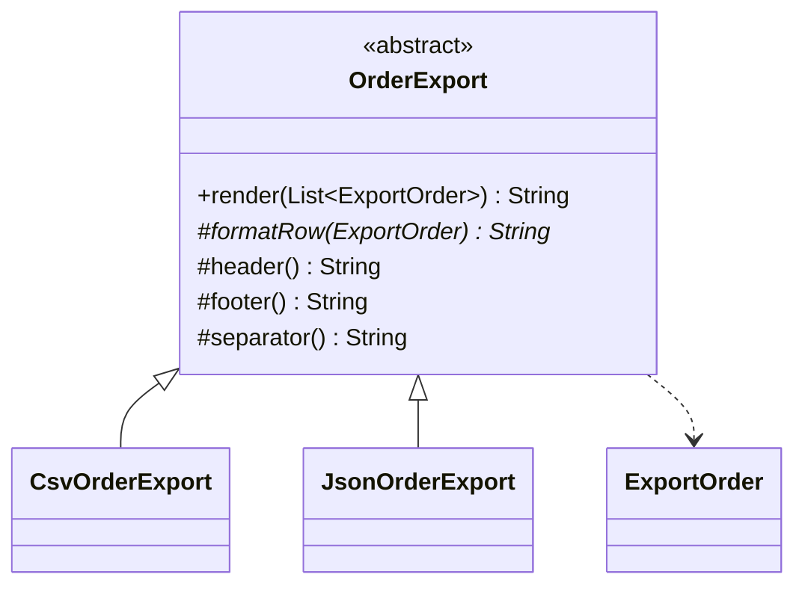

# Template Method

**Intent:** fix the steps of an algorithm in a base class and let subclasses fill in the steps that vary.

## The problem here

Finance wants orders as CSV, and a partner wants the same orders as JSON. Both exports do the same thing: refuse an empty export, write an optional header, one row per order, an optional footer, and join the rows. Copying that loop into each format is how the CSV export ends up rejecting empty lists while the JSON one doesn't. Here, `OrderExport.render()` owns the steps, and each format overrides only `formatRow` and the hooks it needs.

## Shape in Apex



```apex
String csv = new CsvOrderExport().render(orders);   // reference,customer,total + one quoted row each
String json = new JsonOrderExport().render(orders); // [ {...},\n{...} ]
```

Code: [`OrderExport.cls`](classes/OrderExport.cls), [`CsvOrderExport.cls`](classes/CsvOrderExport.cls), [`JsonOrderExport.cls`](classes/JsonOrderExport.cls), [`ExportOrder.cls`](classes/ExportOrder.cls) · Tests: [`OrderExportTest.cls`](classes/OrderExportTest.cls)

## Use it when

- Several variants share a fixed sequence of steps and differ in a few of them.
- The sequence carries rules every variant must keep, such as validation first or cleanup last.
- You control the base class and the variants, typically in one codebase.

## Don't use it when

- **The variants differ in one step only.** Pass that step in as a Strategy instead (`behavioral/strategy`): composition is easier to test than a hierarchy.
- **Subclasses keep needing to skip or reorder steps.** That means the template is wrong. Hooks that return "skip me" flags are a sign to split the class.
- **The hierarchy grows deep.** Template Method works at one level. A subclass of a subclass overriding hooks is hard to follow.

## Salesforce specifics

- **Apex methods are non-virtual by default,** so `render()` can't be overridden without anyone marking it `final`, unlike Java. The template is safe by default; only `abstract` and `virtual` hooks can change.
- **Hooks are `protected`:** subclasses can override them, callers can't call them. Apex rejects `protected static`, so hooks are instance methods.
- **`export` is a reserved word in Apex,** so the template method is `render`.
- **The guard lives in the template,** so every format rejects an empty export without repeating the check (`render_nothingToExport_rejectedForEveryFormat`).
- **Escape per format.** CSV doubles quotes (RFC 4180); JSON uses `JSON.serialize`. Never build JSON by string concatenation.

## See it at scale

- `apex-core-lib`'s [`SObjectDomain`](https://github.com/csquaredaz/apex-core-lib/blob/main/force-app/domain/classes/SObjectDomain.cls) fixes the trigger event order (defaults, then before-insert, validate, after-insert) and leaves `on*` hooks to each domain.
- `apex-event-ingestion`'s example [`OrderMessageHandler`](https://github.com/csquaredaz/apex-event-ingestion/blob/main/example/orders/classes/OrderMessageHandler.cls) parses every message, asks the subclass which changes it acts on, loads their orders in one query, and leaves `apply` to each subclass.

## What the tests prove

| Test                                            | Proves                                                               |
| ----------------------------------------------- | -------------------------------------------------------------------- |
| `render_csv_quotesAndEscapes`                   | Header, then one row per order; commas and quotes stay in one column |
| `render_json_isAValidArray`                     | The JSON export parses back, with names intact                       |
| `render_defaultsOnly_noHeaderOrFooter`          | A subclass with only `formatRow` gets the default hooks              |
| `render_nothingToExport_rejectedForEveryFormat` | The template's guard applies to every subclass                       |
| `render_twoHundredOrders_oneRowEach`            | 200 orders give one header and 200 rows                              |
