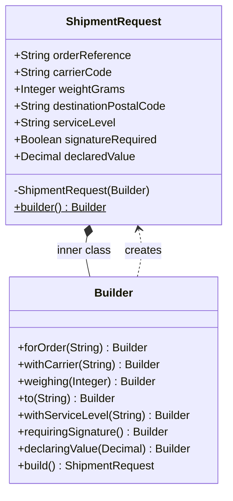

# Builder

**Intent:** build a complex value step by step, and validate it once, when it's complete.

## The problem here

A shipment booking needs an order reference, a carrier, a weight and a destination, plus optional extras: a service level, a signature and a declared value. Apex has no named arguments, so a seven-parameter constructor is unreadable at the call site (`new ShipmentRequest('ORD-1', 'PARCELCO', 1200, 'SW1A 1AA', null, true, null)`). Telescoping overloads multiply, and a mutable class with public setters lets half-built requests escape.

## Shape in Apex



```apex
ShipmentRequest request = ShipmentRequest.builder()
  .forOrder('ORD-1001')
  .withCarrier('parcelco')
  .weighing(1200)
  .to('SW1A 1AA')
  .requiringSignature()
  .build(); // throws InvalidRequestException naming every missing field
```

Code: [`ShipmentRequest.cls`](classes/ShipmentRequest.cls) · Tests: [`ShipmentRequestTest.cls`](classes/ShipmentRequestTest.cls)

## Use it when

- A value has several optional parts, or required parts that are easy to mix up at the call site.
- The value must be valid and immutable once it exists, for example a request handed to a callout or a message put on a queue.
- You want every validation error reported at once, not one per attempt.

## Don't use it when

- **The type is an SObject.** `new Order(Name = 'ORD-1', Status = 'Draft')` already gives you named fields. A builder around an SObject only adds a second place to forget a field. The exception is a test data factory, where builder-style defaults (`aShipment().shipped().build()`) do earn their keep.
- **There are two or three fields, all required.** Use a constructor. A builder is ceremony for a value that a constructor states plainly.
- **The value is mutable by design**, such as a form-state object. Validating once at `build()` is the point; if the value keeps changing afterwards, validate where it changes instead.

## Salesforce specifics

- **The builder is an inner class** so it can call the outer class's `private` constructor. That's the only way to guarantee that every `ShipmentRequest` went through `build()`. A top-level `ShipmentRequestBuilder` would need a public constructor that anyone could call.
- **`public final` fields** make the value immutable without getters. Apex allows assigning a `final` field once in the constructor.
- **The Stub API can't mock inner types.** That's fine here: a value object should be built for real in tests, not mocked. Mock the service that receives it.
- **Heap and CPU are trivial.** One builder can be reused in a loop (the 200-request test), because `build()` copies the fields into a new object.

## See it at scale

[`CalloutRequest`](https://github.com/csquaredaz/apex-core-lib/blob/main/force-app/callout/classes/CalloutRequest.cls) in `apex-core-lib` is a fluent Builder for outbound HTTP requests. It enforces `callout:` endpoints (Named Credentials only), and it answers `isIdempotent()` for its retry policy.

## What the tests prove

| Test                                                    | Proves                                                                                                                          |
| ------------------------------------------------------- | ------------------------------------------------------------------------------------------------------------------------------- |
| `build_allRequiredFields_appliesDefaultsAndNormalises`  | The defaults apply, and the carrier and postal code are normalised                                                              |
| `build_optionalFields_overridesDefaults`                | Each optional step overrides its default                                                                                        |
| `build_emptyBuilder_listsEveryMissingField`             | One exception names every missing field                                                                                         |
| `build_outOfRangeValues_rejected`                       | A zero or negative weight, a negative value, a blank level, or a null carrier or postal code fails without a null-pointer error |
| `build_builderReusedAfterBuild_earlierRequestUnchanged` | Built requests are immutable, even when the builder is reused                                                                   |
| `build_twoHundredRequests_eachIndependent`              | One builder in a 200-row loop gives 200 independent values                                                                      |
