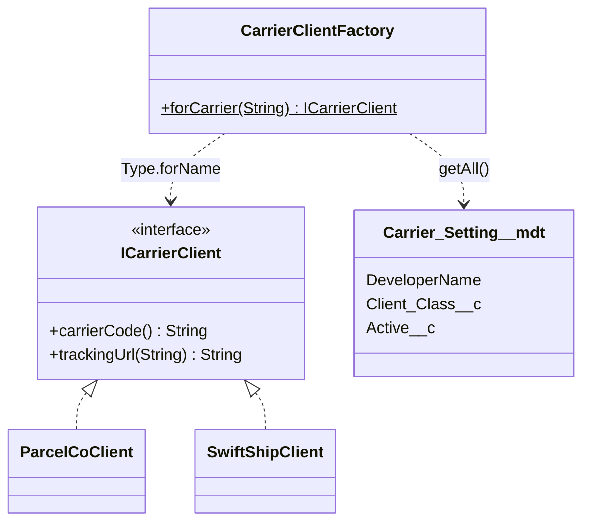

# Factory (configuration-driven)

**Intent:** decide which class to create from configuration, so callers depend only on an interface and a new variant needs no change to them.

## The problem here

Shipping code needs a client for whichever carrier an order uses. An `if (carrier == 'PARCELCO') … else if …` chain gets copied into every caller, and every new carrier means editing and redeploying all of them. Here, a `Carrier_Setting__mdt` row maps each carrier code to an Apex class, and the factory creates that class with `Type.forName`.

## Shape in Apex



```apex
ICarrierClient client = CarrierClientFactory.forCarrier(order.carrierCode);
String url = client.trackingUrl(trackingNumber);
```

Code: [`CarrierClientFactory.cls`](classes/CarrierClientFactory.cls), [`ICarrierClient.cls`](classes/ICarrierClient.cls), [`ParcelCoClient.cls`](classes/ParcelCoClient.cls), [`SwiftShipClient.cls`](classes/SwiftShipClient.cls), [`Carrier_Setting__mdt`](objects/Carrier_Setting__mdt) · Tests: [`CarrierClientFactoryTest.cls`](classes/CarrierClientFactoryTest.cls)

## Use it when

- The set of variants grows over time (carriers, payment providers, tax engines), and adding one should be a new class plus a row of configuration.
- Admins or a release need to switch a variant on or off without a code change (`Active__c`).
- A subscriber org must plug its own implementation into code it doesn't own. The factory finds a class it was never compiled against.

## Don't use it when

- **There are two variants and that won't change.** An `if` or a `switch on` is clearer and is checked by the compiler. A misspelled class name in metadata fails only at run time.
- **The variant depends on per-call data,** such as the basket's weight. That's a Strategy chosen in code (see `behavioral/strategy`), not configuration.
- **You need dependency injection across a whole app.** Grow this into a container with interface-keyed bindings and test mocks, as `apex-core-lib` does, rather than writing one static factory per interface.

## Salesforce specifics

- **`Carrier_Setting__mdt.getAll()` costs no SOQL query** and is cached by the platform; the 200-call test proves no query is spent. Custom Metadata also deploys with the code, unlike Custom Settings data.
- **`Type.forName` returns null for an unknown class** rather than throwing, and `newInstance()` needs a public no-argument constructor. The factory checks for null, then checks `ICarrierClient.class.isAssignableFrom(type)` _before_ `newInstance()`, so a row that names the wrong class never runs that class's constructor. A bad row fails with a message that names the carrier and the class.
- **Tests don't depend on deployed rows.** A `@TestVisible` static seam takes rows built in memory (`new Carrier_Setting__mdt(DeveloperName = …)`).
- **`getAll()` keys rows by DeveloperName as stored,** so the factory matches carrier codes case-insensitively.

## See it at scale

`apex-core-lib`'s DI container ([`ServiceFactory`](https://github.com/csquaredaz/apex-core-lib/blob/main/force-app/di/classes/ServiceFactory.cls), [`Application`](https://github.com/csquaredaz/apex-core-lib/blob/main/force-app/di/classes/Application.cls)) is this pattern grown up: `DI_Binding__mdt` rows bind interfaces to classes ([ADR 0004](https://github.com/csquaredaz/apex-core-lib/blob/main/docs/adr/0004-di-bindings-in-custom-metadata.md)), with code defaults and `setMock` for tests.

## What the tests prove

| Test                                                  | Proves                                                                                |
| ----------------------------------------------------- | ------------------------------------------------------------------------------------- |
| `forCarrier_shippedRows_resolveBothCarriers`          | The two deployed rows resolve to working clients                                      |
| `forCarrier_codeInAnyCase_resolvesConfiguredClass`    | The row decides the class, and carrier codes match in any case                        |
| `forCarrier_unresolvable_explainsWhy`                 | A missing or inactive row, a misspelled class or a non-client class each fail clearly |
| `forCarrier_twoHundredCalls_noQueriesAndNewInstances` | 200 lookups spend no SOQL, and each call creates a new client                         |
