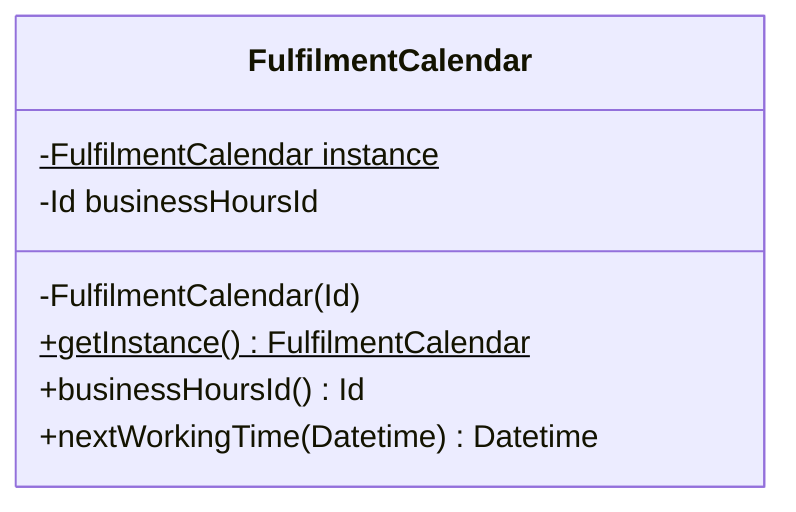

# Singleton (transaction-scoped)

**Intent:** give every caller in a transaction one shared instance, created the first time it's needed.

## The problem here

A trigger on 200 orders works out when the warehouse can start on each one, using the org's default business hours. If every order queries `BusinessHours` itself, one trigger chunk spends 200 of the 100 SOQL queries allowed and fails. `FulfilmentCalendar.getInstance()` queries once, on first use, and every later caller in the transaction gets the same instance.

## Shape in Apex



```apex
for (Order o : orders) {
  Datetime startBy = FulfilmentCalendar.getInstance().nextWorkingTime(o.CreatedDate); // 1 query in total
}
```

Code: [`FulfilmentCalendar.cls`](classes/FulfilmentCalendar.cls) · Tests: [`FulfilmentCalendarTest.cls`](classes/FulfilmentCalendarTest.cls)

## Use it when

- A value is expensive to load (a query, a describe, a parse) and the same for every caller in a transaction.
- Many unrelated callers need it and passing it down through every method would be noise.

## Don't use it when

- **You expect it to live longer than a transaction.** A static field starts empty in every transaction: each Queueable, each batch `execute`, each Platform Event trigger run and each Visualforce or Aura request. For data shared across transactions, use Platform Cache (with a fallback for a cache miss) or Custom Metadata.
- **The state is per caller,** such as "the current order". A shared mutable instance leaks state between callers. Pass the value instead.
- **It hides a dependency you'll want to replace in tests.** A static `getInstance()` can't be swapped with the Stub API. If callers need a fake, inject the dependency (see `structural/facade`), or resolve it through a DI container.
- **Two callers can see different data.** A `with sharing` query cached by the first caller is returned to every later caller, whoever they are. Cache only what doesn't depend on the running user, like the default business hours here.

## Salesforce specifics

- **"Singleton" means once per transaction,** not once per org or per user. That's why this pattern is mostly a governor-limit tool on the platform.
- **`Test.startTest()` doesn't reset statics.** A value cached during test setup is still there in the act phase, so a `@TestVisible reset()` lets a test reload it, as a new transaction would.
- **The constructor is private,** so `getInstance()` is the only way in. Lazy loading means a transaction that never needs the calendar never spends the query.
- **Selectors own SOQL in production code** (ADR 0004). At scale, the query would live in a `BusinessHoursSelector`, and the Singleton would call it.

## See it at scale

`apex-event-ingestion`'s [`IngestionSettings`](https://github.com/csquaredaz/apex-event-ingestion/blob/main/force-app/processing/classes/IngestionSettings.cls) reads its Custom Metadata row once and has a `@TestVisible` seam for tests.

## What the tests prove

| Test                                            | Proves                                                             |
| ----------------------------------------------- | ------------------------------------------------------------------ |
| `getInstance_calledTwice_returnsSameInstance`   | One shared instance (`===`)                                        |
| `getInstance_twoHundredCallers_queryOnce`       | 200 callers spend exactly one SOQL query                           |
| `getInstance_loadsTheDefaultBusinessHours`      | It holds the org's default business hours                          |
| `nextWorkingTime_matchesThePlatformCalculation` | The result is never earlier than the input, and is working time    |
| `reset_nextCaller_reloads`                      | After a reset (like a new transaction), the next caller reloads it |
