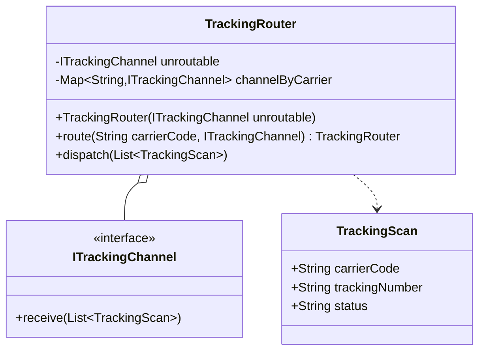

# Content-Based Router

**Intent:** send each message to the right destination by looking at what's inside it, so senders don't need to know the destinations.

## The problem here

Tracking scans from every carrier arrive in one stream: an inbound REST endpoint, a Platform Event, or a batch file. ParcelCo's scans need ParcelCo's status mapping, and SwiftShip's need SwiftShip's. If the intake code calls each carrier's processor with an `if`, every new carrier means editing intake, and an unknown carrier either crashes the batch or disappears. `TrackingRouter` reads each scan's `carrierCode`, hands each channel its scans in one call, and sends anything it can't route to a required unroutable channel.

## Shape in Apex



```apex
TrackingRouter router = new TrackingRouter(new UnroutableScans())
  .route('parcelco', new ParcelCoScans())
  .route('swiftship', new SwiftShipScans());
router.dispatch(scans); // each channel once, with its scans in arrival order
```

Code: [`TrackingRouter.cls`](classes/TrackingRouter.cls), [`ITrackingChannel.cls`](classes/ITrackingChannel.cls), [`TrackingScan.cls`](classes/TrackingScan.cls) · Tests: [`TrackingRouterTest.cls`](classes/TrackingRouterTest.cls)

## Use it when

- One inbound stream carries messages that different code must handle, and the choice depends on a field in the message.
- New destinations are added more often than the routing rule changes.
- Unknown messages must be kept and looked at, not lost.

## Don't use it when

- **Every message goes to the same place.** A router with one route is an extra hop.
- **The choice depends on many fields, or on order.** Ordered rules ("high value first, then by carrier") are a Chain of Responsibility (`behavioral/chain-of-responsibility`), not a keyed lookup.
- **Every destination needs every message.** That's Publish-Subscribe (`eip/publish-subscribe`): broadcast, don't route.
- **Admins should own the routes.** Keep the routes in Custom Metadata instead of code, as `apex-event-ingestion` does (below), so a new route is a deploy of a record, not of Apex.

## Salesforce specifics

- **Route in bulk.** Each channel gets one `receive` call per batch, so a channel that queries or writes does it once, not once per scan. A trigger or a Platform Event subscriber can hand a router up to 2,000 messages at once.
- **Keep the unroutable messages.** The constructor requires an unroutable channel (EIP's Invalid Message Channel). In production it stores or logs them; dropping them silently is how a new carrier's scans go missing for a week.
- **Keys are case-insensitive.** Carrier codes come from outside, so `ParcelCo`, `PARCELCO` and `parcelco` share a route. A second route for the same carrier is rejected, so a typo can't shadow a route.
- **Order is deterministic.** Channels are called in the order their first scan arrived, tracked in lists rather than a Map, whose iteration order isn't a documented contract.

## See it at scale

`apex-event-ingestion`'s [`MessageRouter`](https://github.com/csquaredaz/apex-event-ingestion/blob/main/force-app/dispatch/classes/MessageRouter.cls) routes stored messages by type with `Message_Route__mdt` rows, builds handlers with `Type.forName` (checking the type before constructing it), combines several handlers for one type with a Composite, and turns a misconfigured route into a guarded handler rather than a crash ([ADR 0004](https://github.com/csquaredaz/apex-event-ingestion/blob/main/docs/adr/0004-command-composite-dispatch.md)).

## What the tests prove

| Test                                                          | Proves                                                                               |
| ------------------------------------------------------------- | ------------------------------------------------------------------------------------ |
| `dispatch_twoHundredMixedScans_eachChannelOnceInArrivalOrder` | 200 mixed scans: one call per channel, first-seen order, arrival order kept in each  |
| `dispatch_carrierCodeInAnyCase_matchesItsRoute`               | Carrier codes match case-insensitively and trimmed                                   |
| `dispatch_unknownOrMissingCarrier_goesToUnroutableChannel`    | Unknown, null, blank and missing scans all reach the unroutable channel, in one call |
| `dispatch_emptyOrNullBatch_callsNoChannel`                    | Nothing to route calls nothing                                                       |
| `construction_invalidRoutes_rejected`                         | No unroutable channel, a blank code, a null channel or a duplicate route is rejected |
