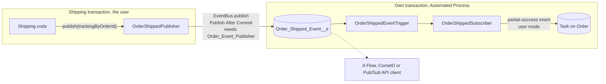

# Publish-Subscribe Channel (Platform Events)

**Intent:** announce an event on a channel so any number of subscribers can react, each on its own, without the publisher knowing who they are.

## The problem here

When an order ships, a Task should appear on the Order's activity timeline, and later a loyalty service, a Flow and an external warehouse system may want to know too. The in-transaction Observer (`behavioral/observer`) can't serve them: a listener that throws rolls back the shipment, and an external system can't join a transaction at all. `OrderShippedPublisher` publishes `Order_Shipped_Event__e` after the shipment commits. `OrderShippedEventTrigger` is one subscriber: it runs in its own transaction, as the Automated Process user, and writes a completed Task per event through `OrderShippedSubscriber`.

## Shape in Apex



```apex
OrderShippedPublisher.publish(new Map<Id, String>{ orderId => 'TRK-1001' });
// throws OrderEventPublishException if the user may not publish; subscribers run after commit
```

Code: [`OrderShippedPublisher.cls`](classes/OrderShippedPublisher.cls), [`OrderShippedSubscriber.cls`](classes/OrderShippedSubscriber.cls), [`OrderEventPublishException.cls`](classes/OrderEventPublishException.cls), [`OrderShippedEventTrigger`](triggers/OrderShippedEventTrigger.trigger), the event [`Order_Shipped_Event__e`](objects/Order_Shipped_Event__e) and the permission set [`Order_Event_Publisher`](permissionsets/Order_Event_Publisher.permissionset-meta.xml) · Tests: [`OrderShippedPublisherTest.cls`](classes/OrderShippedPublisherTest.cls)

## Use it when

- Subscribers must not be able to break the publisher, or each other: each gets its own transaction, limits and retries.
- Subscribers live outside Apex: Flows, external systems over CometD or the Pub/Sub API, other orgs through middleware.
- The work can happen a moment later. Delivery is asynchronous.

## Don't use it when

- **The consumer must succeed or fail with the publisher**, for example a balance that must never disagree with a shipment. Use the in-transaction Observer.
- **The publisher needs an answer.** Publish-Subscribe is fire and forget: the publisher learns only that the event was accepted. Use a request/reply call.
- **You need ordering or exactly-once.** Platform Events are delivered at least once, and order isn't guaranteed across publishers. Subscribers must be idempotent (see `apex-event-ingestion`'s [ADR 0005](https://github.com/csquaredaz/apex-event-ingestion/blob/main/docs/adr/0005-no-ordering-guarantee.md)).
- **There's one subscriber, in Apex, and always will be.** A Queueable is simpler, and easier to test and trace.

## Salesforce specifics

- **Publishing needs Create on the event,** even from Apex: `EventBus.publish` checks the running user. Without it the publish doesn't throw; each `SaveResult` fails with `CANNOT_INSERT_UPDATE_ACTIVATE_ENTITY`, which is easy to miss. The publisher turns failed results into `OrderEventPublishException`, and the test proves it with a Minimum Access user who lacks the permission set. Ship the permission set (Read and Create on the event; event fields have no FLS).
- **A successful result can carry an "error" too.** In the probe, a successful publish returned `isSuccess() = true` with an `OPERATION_ENQUEUED` entry in `getErrors()`. Check `isSuccess()`, not the error list.
- **Publish After Commit, not Immediately.** Subscribers hear only about shipments that committed; a rollback discards the event. `apex-platform-logging` makes the opposite choice on purpose: a log must survive the rollback it describes.
- **The subscriber runs as the Automated Process user,** not the publisher. A scratch-org probe (2026-11-18) showed that user, with no permission set, can insert Tasks on Orders in user mode, and that with no `OwnerId` it owns them. Set `OwnerId` (for example to the Order's owner) if people should see the Tasks in their own lists.
- **One bad event mustn't block the batch.** The subscriber inserts with partial success, so an event naming an Order that doesn't exist (or a Task a validation rule refuses) is skipped and the rest are written. An all-or-none insert would fail the whole batch, be retried, and finally suspend the trigger, a poison message. Production code logs or dead-letters the skipped events rather than dropping them (see below). A deleted Order is not a failure: its Task still inserts.
- **Don't trust the payload.** Any publisher can reach the channel (Apex, Flow, REST, Pub/Sub API), so the subscriber checks that `Order_Id__c` parses as an Order's Id before using it.
- **Hard-coded picklist values.** `Completed` and `Normal` are the default Task values. An org with custom Task statuses should look up a closed status (`TaskStatus WHERE IsClosed = true`) instead.
- **Testing:** `Test.getEventBus().deliver()` delivers the events the test published and runs the trigger. Before it, the subscriber hasn't run, which the test asserts. A test that assigns a permission set and then inserts a Task in the same context fails with `MIXED_DML_OPERATION`, so the direct subscriber call runs in a fresh `System.runAs`.

## See it at scale

- `apex-platform-logging` publishes `Log_Event__e` Publish Immediately, and its subscriber persists log rows and raises Slack alerts, with a kill switch and a Unit of Work ([README](https://github.com/csquaredaz/apex-platform-logging#readme)).
- `apex-event-ingestion` takes producers' messages through a high-volume event, stores each one once, and uses `RetryableException` and resume checkpoints for failures ([ADR 0007](https://github.com/csquaredaz/apex-event-ingestion/blob/main/docs/adr/0007-platform-event-intake.md)), with a Dead Letter Channel for messages that keep failing ([ADR 0006](https://github.com/csquaredaz/apex-event-ingestion/blob/main/docs/adr/0006-queueable-finalizer-recovery.md)).

## What the tests prove

| Test                                                               | Proves                                                                                                                                  |
| ------------------------------------------------------------------ | --------------------------------------------------------------------------------------------------------------------------------------- |
| `publish_twoHundredOrdersAsPublisher_subscriberWritesATaskForEach` | A Minimum Access user with the permission set publishes 200; nothing runs before delivery, then 200 Tasks, written by Automated Process |
| `publish_withoutThePermissionSet_throwsAndNothingIsDelivered`      | Without the permission set the publish throws, naming the Order, and no Task appears                                                    |
| `handle_missingOrderOrBadId_skippedAndTheRestWritten`              | A non-existent Order, a blank, a non-Id and a non-Order Id are skipped; the rest are written                                            |
| `publish_invalidInput_rejectedOrIgnored`                           | Empty input publishes nothing; a null Id or blank tracking number is rejected                                                           |
