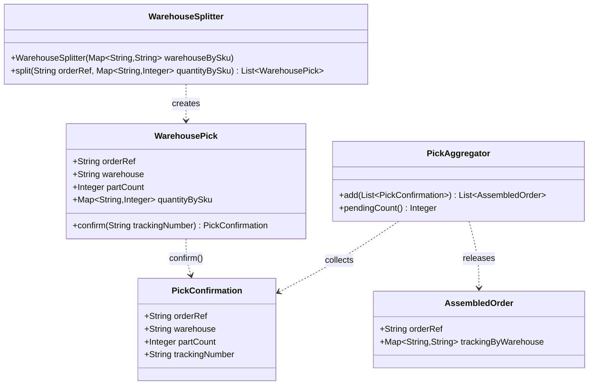

# Splitter + Aggregator

**Intent:** break one message into parts that are processed independently (Splitter), then collect the replies and release one combined result once every part is back (Aggregator).

## The problem here

An order for a mug, a kettle and a tray is stocked in three warehouses. Each warehouse picks and ships its own parcel and confirms separately, in any order, sometimes twice. The customer should get one "your order has shipped" message, with every tracking number, only when all three parcels are out. `WarehouseSplitter` turns the order into one `WarehousePick` per warehouse, each carrying the order reference (the correlation id) and how many picks the order became. `PickAggregator` groups confirmations by order and releases an `AssembledOrder` when it holds that many.

## Shape in Apex



```apex
List<WarehousePick> picks = new WarehouseSplitter(warehouseBySku).split('ORD-1', quantityBySku);
// ... each warehouse ships, and its confirmation comes back:
List<AssembledOrder> done = aggregator.add(new List<PickConfirmation>{ picks[0].confirm('TRK-1') });
// done is empty until the last of the order's picks is confirmed
```

Code: [`WarehouseSplitter.cls`](classes/WarehouseSplitter.cls), [`WarehousePick.cls`](classes/WarehousePick.cls), [`PickConfirmation.cls`](classes/PickConfirmation.cls), [`PickAggregator.cls`](classes/PickAggregator.cls), [`AssembledOrder.cls`](classes/AssembledOrder.cls) · Tests: [`WarehouseSplitterTest.cls`](classes/WarehouseSplitterTest.cls), [`PickAggregatorTest.cls`](classes/PickAggregatorTest.cls). This card has two test classes, one per side, because the two halves fail in different ways.

## Use it when

- One request fans out to parts that complete separately (warehouses, carriers, approvers), and something downstream needs the whole answer.
- Replies can arrive late, out of order or more than once.
- The number of parts is known when you split, so completeness is a count, not a guess.

## Don't use it when

- **The parts finish in the same transaction.** If the split, the work and the result all happen in one Apex call, a loop and a list are enough.
- **Nobody needs the combined result.** If each part's reply is useful on its own (each parcel's tracking email), skip the aggregator and handle replies one by one.
- **You can't say when it's complete.** An aggregator needs a completion rule: a count, a "last part" flag or a timeout. Without one it holds state forever.
- **The state can't live in one transaction and you have nowhere to store it.** This aggregator is in memory (ADR 0004). In production the confirmations arrive in different transactions, so the aggregator's state belongs in a record, with a unique key per part.

## Salesforce specifics

- **Correlation travels with the message.** A confirmation is built from its pick (`pick.confirm(trackingNumber)`), so it can only carry a real order reference and part count. The aggregator never asks the splitter how many parts there were.
- **Duplicates are harmless.** Platform Events, retries and humans all repeat themselves. A second confirmation for the same order and warehouse is ignored, and a released order is never released again.
- **A batch is all or nothing.** The aggregator checks the whole batch before applying any of it, so a confirmation whose part count disagrees can't leave the batch half applied.
- **A splitter never drops lines.** A SKU with no warehouse fails the split and names every such SKU, because a silently missing line is a short shipment.
- **Deterministic output.** Picks come out sorted by warehouse rather than in a Map's key order, which isn't a documented contract.
- **Production gaps, named:** persisted state (one row per order and part, unique on both), and a timeout for picks that never come back. Both have production forms in `apex-event-ingestion` (below).

## See it at scale

`apex-event-ingestion` has the parts a real aggregator needs: a [Message Store](https://github.com/csquaredaz/apex-event-ingestion/blob/main/docs/adr/0002-message-store.md) for state that outlives a transaction, an [idempotency key](https://github.com/csquaredaz/apex-event-ingestion/blob/main/docs/adr/0003-producer-idempotency-key.md) enforced by a unique index, and a [stall sweeper](https://github.com/csquaredaz/apex-event-ingestion/blob/main/docs/adr/0009-stall-sweeper.md) that finds work that never finished, which is the aggregator's timeout.

## What the tests prove

| Test                                                                 | Proves                                                                          |
| -------------------------------------------------------------------- | ------------------------------------------------------------------------------- |
| `split_linesAcrossThreeWarehouses_onePickEachWithItsLines`           | One pick per warehouse, sorted, each with its own lines and the correlation     |
| `split_oneWarehouse_onePickOfOne`                                    | An order from one warehouse is one pick of one                                  |
| `split_skusWithNoWarehouse_rejectedNamingEveryOne`                   | Unmapped or blank-mapped SKUs fail the split, and all of them are named         |
| `split_invalidInput_rejected`                                        | No lines, a non-positive quantity, a blank reference or no stocking table       |
| `split_twoHundredLines_eachOnItsWarehousesPick`                      | 200 lines over 4 warehouses: none lost or duplicated                            |
| `add_allPartsInAnyOrder_releasesTheOrderOnceWithEveryTrackingNumber` | Out-of-order parts: released only when complete, with every tracking number     |
| `add_repeatedConfirmations_ignored`                                  | A repeat isn't a new part, the first copy wins, and a late copy can't reopen it |
| `add_conflictingPartCount_rejectsTheWholeBatch`                      | A disagreeing part count rejects the batch and applies nothing                  |
| `add_invalidInput_handled`                                           | Null batches, null confirmations, and confirmations without a pick or tracking  |
| `add_twoHundredOrdersInterleaved_eachReleasedOnce`                   | 200 interleaved orders are each released once, in completion order              |
