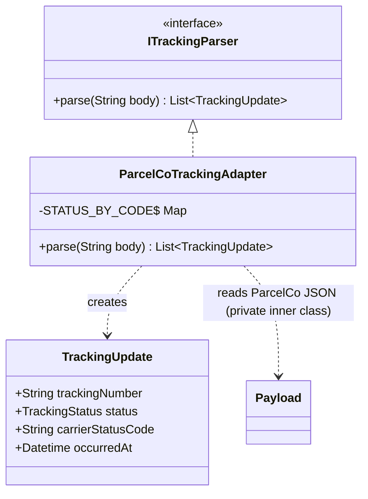

# Adapter

**Intent:** let our code use something whose interface doesn't fit, by putting a translating class between them. EIP calls the message-level version a Message Translator.

## The problem here

Carriers post tracking webhooks in their own formats. ParcelCo sends `{"parcels":[{"ref":"PC1","events":[{"code":"DLV","ts":1763459400000}]}]}`, with its own status codes and epoch milliseconds. If that shape leaks past the webhook endpoint, every consumer learns ParcelCo's codes, and a second carrier doubles the work. Here, our code depends on `ITrackingParser` and our own `TrackingUpdate`, and one adapter per carrier is the only class that knows the carrier's format.

## Shape in Apex



```apex
ITrackingParser parser = new ParcelCoTrackingAdapter();
for (TrackingUpdate u : parser.parse(RestContext.request.requestBody.toString())) {
  // our statuses only: IN_TRANSIT, OUT_FOR_DELIVERY, DELIVERED, FAILED_ATTEMPT, UNKNOWN
}
```

Code: [`ParcelCoTrackingAdapter.cls`](classes/ParcelCoTrackingAdapter.cls), [`ITrackingParser.cls`](classes/ITrackingParser.cls), [`TrackingUpdate.cls`](classes/TrackingUpdate.cls), [`TrackingStatus.cls`](classes/TrackingStatus.cls) · Tests: [`ParcelCoTrackingAdapterTest.cls`](classes/ParcelCoTrackingAdapterTest.cls)

## Use it when

- An external system's payload or API shape is outside your control and shouldn't spread through your code.
- Several sources (carriers, payment providers) must look the same to the rest of the system.
- You want one place to absorb a vendor's change.

## Don't use it when

- **You own both sides.** Change one of them to fit instead of adding a translator.
- **The shapes are already the same.** A pass-through adapter is a class that only renames things.
- **Different callers need different views** of the same source. An adapter per view multiplies classes; consider one canonical model (as here) that each caller reads from.

## Salesforce specifics

- **`JSON.deserialize` into private inner classes** keeps the vendor's wire format inside the adapter. Field names must match the JSON keys, and unknown keys are ignored, so an extra `version` field does no harm.
- **Be a tolerant reader.** An unknown status code maps to `UNKNOWN` and keeps the raw code, so a carrier's new code doesn't drop the whole webhook. Only a payload that isn't the carrier's format at all throws `TrackingFormatException`.
- **`JSON.deserialize('null', …)` returns null rather than throwing,** so the adapter checks for a missing `parcels` list explicitly.
- **Wrap `JSONException`** in your own exception with the cause attached. Callers then catch one type per adapter, not platform internals.

## See it at scale

`apex-platform-logging`'s [`SlackAlertSink`](https://github.com/csquaredaz/apex-platform-logging/blob/main/force-app/alerting/classes/SlackAlertSink.cls) adapts `apex-core-lib`'s `IAlertSink` port to Slack's Block Kit webhook (Ports and Adapters).

## What the tests prove

| Test                                          | Proves                                                                                     |
| --------------------------------------------- | ------------------------------------------------------------------------------------------ |
| `parse_knownCodes_mapToOurStatuses`           | Every known code maps to our status, and epoch millis become a `Datetime`                  |
| `parse_unknownCodeAndMissingFields_tolerated` | An unknown code becomes `UNKNOWN` with the raw code kept; missing or extra fields are fine |
| `parse_notTheCarrierFormat_rejected`          | An empty body, invalid JSON, a wrong shape or `null` throw `TrackingFormatException`       |
| `parse_twoHundredParcels_allMapped`           | 200 parcels map in payload order                                                           |
