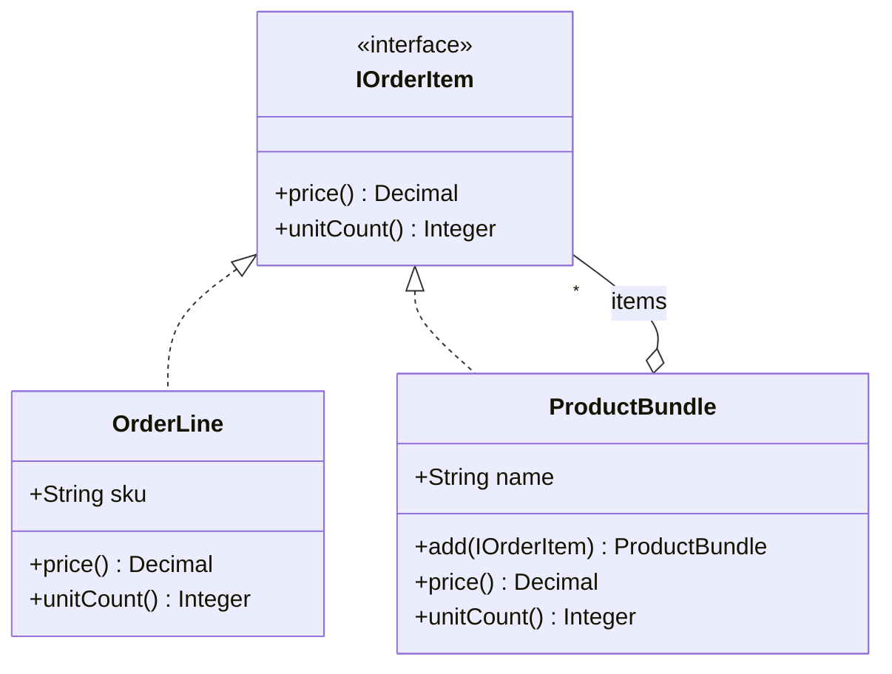

# Composite

**Intent:** treat a single item and a group of items through one interface, so code works on trees without asking what each node is.

## The problem here

An order holds lines (`MUG × 2`) and bundles (a coffee set at 10% off), and bundles can hold other bundles (refills inside a gift box). Pricing code that asks "is this a line or a bundle?" at every level gets a type check per level, and breaks when someone nests one level deeper. Here, `OrderLine` and `ProductBundle` both implement `IOrderItem`, and a bundle prices itself by asking its children.

## Shape in Apex



```apex
ProductBundle giftBox = new ProductBundle('Gift box', 10)
  .add(new ProductBundle('Refills', 50).add(new OrderLine('BEANS', 10, 2)))
  .add(new OrderLine('MUG', 10, 1));
giftBox.price(); // 18.00: ((20 × 50%) + 10) × 90%
```

Code: [`IOrderItem.cls`](classes/IOrderItem.cls), [`OrderLine.cls`](classes/OrderLine.cls), [`ProductBundle.cls`](classes/ProductBundle.cls) · Tests: [`ProductBundleTest.cls`](classes/ProductBundleTest.cls)

## Use it when

- The data is a tree (bundles, org hierarchies, bills of materials, nested approval rules), and callers should handle a leaf and a branch the same way.
- One operation (price, count, validate) must run over the whole tree.

## Don't use it when

- **The tree is always one level deep.** A list of lines with a bundle discount field is simpler.
- **Leaves and groups need different operations.** If only bundles can be renamed or only lines have a SKU, a shared interface either grows methods that half its implementers can't support, or callers start type-checking again.
- **The tree lives in records** (`Product2` bundles, parent Account chains). Walking it node by node means a query per level. Query the whole tree in one selector call, build the composite in memory, then operate on it.

## Salesforce specifics

- **Recursion depth is bounded by the stack, not by SOQL**: in memory, a deep tree costs CPU only. Building the tree from records is where limits bite, so load the rows in bulk first.
- **Guard the obvious cycle.** `add` rejects the bundle itself. A cycle through another bundle (A contains B contains A) would recurse until the stack overflows. Data from records should be validated for cycles when it's loaded.
- **Decimal rounding happens at each level** (`setScale(2, HALF_UP)`), as an invoice would show it. If you need exact totals, round only at the top.

## See it at scale

`apex-event-ingestion`'s [`CompositeMessageHandler`](https://github.com/csquaredaz/apex-event-ingestion/blob/main/force-app/dispatch/classes/CompositeMessageHandler.cls) lets several handlers stand in for one route, and returns the most severe result (ADR 0004 there).

## What the tests prove

| Test                                    | Proves                                                                       |
| --------------------------------------- | ---------------------------------------------------------------------------- |
| `price_lineAndBundle_treatedAlike`      | A caller prices lines and bundles through `IOrderItem` alone                 |
| `price_nestedBundles_applyEachDiscount` | Nested bundles apply their own discount, then the parent's                   |
| `price_emptyBundle_isZero`              | An empty bundle prices at zero                                               |
| `build_invalidItems_rejected`           | Adding itself or null, bad discounts, quantities and prices are all rejected |
| `price_twoHundredLines_summed`          | A 200-line bundle sums exactly                                               |
