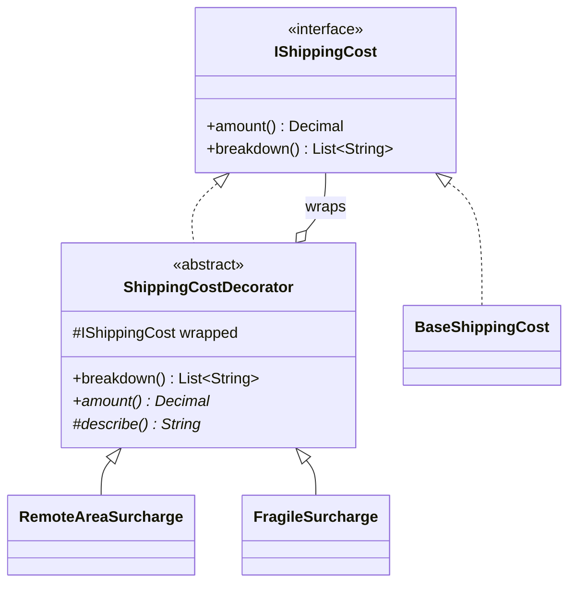

# Decorator

**Intent:** add behaviour to an object by wrapping it in another object with the same interface, so the extras combine freely and the original class doesn't change.

## The problem here

A shipping cost starts from the carrier's base rate. Remote areas add a flat fee, and fragile parcels add a percentage. With subclasses you'd need `RemoteFragileCost`, `FragileRemoteCost` and so on: one class per combination. Here, each surcharge wraps an `IShippingCost` and is one itself, so any stack works, and each layer adds its own line to the breakdown.

## Shape in Apex



```apex
IShippingCost cost = new FragileSurcharge(new RemoteAreaSurcharge(new BaseShippingCost(10), 5), 10);
cost.amount();    // 16.50
cost.breakdown(); // Base rate: 10.00 / Remote area: +5.00 / Fragile handling: +10%
```

Code: [`IShippingCost.cls`](classes/IShippingCost.cls), [`ShippingCostDecorator.cls`](classes/ShippingCostDecorator.cls), [`BaseShippingCost.cls`](classes/BaseShippingCost.cls), [`RemoteAreaSurcharge.cls`](classes/RemoteAreaSurcharge.cls), [`FragileSurcharge.cls`](classes/FragileSurcharge.cls) · Tests: [`ShippingCostDecoratorTest.cls`](classes/ShippingCostDecoratorTest.cls)

## Use it when

- Optional behaviours combine in many ways, and a subclass per combination would explode.
- You need to add a cross-cutting concern (security checks, savepoints, logging, caching) around an interface without touching its implementations.
- The extras are chosen at run time, for example from the order's attributes.

## Don't use it when

- **The order of layers matters but nobody controls it.** A percentage on top of a flat fee gives a different total from the reverse (the stack-order test). If the business has one correct order, build the stack in one place, or use a single calculator with explicit steps.
- **There's one fixed combination.** A single class is easier to read than three wrappers.
- **The wrapper needs the wrapped object's internals.** A decorator only sees the interface. If it needs more, it's a subclass or a change to the original class.
- **You want to control access to the object rather than add to it.** That's a Proxy (for example lazy loading or a cache in front of a selector). The shape is the same; the intent differs.

## Salesforce specifics

- **`inner` and `outer` are reserved words in Apex,** so the wrapped field is named `wrapped`.
- **The abstract base holds the wrapping and the breakdown,** so a new surcharge is one constructor, `amount()` and `describe()`. Apex rejects `protected static`, so shared behaviour lives in instance methods.
- **Decorators are easy to Stub API test:** stub the interface and assert that the decorator calls it once per call. The Stub API can mock only top-level interfaces, so keep the decorated interface top-level.
- **Depth is cheap.** 200 stacked layers in the bulk test stay well inside the CPU and stack limits, but real stacks should stay short enough to read.

## See it at scale

- `apex-core-lib`'s [`StripInaccessibleDml`](https://github.com/csquaredaz/apex-core-lib/blob/main/force-app/data/classes/StripInaccessibleDml.cls) wraps any `IDml` and removes fields the user can't write before delegating.
- `apex-event-ingestion`'s [`GuardedMessageHandler`](https://github.com/csquaredaz/apex-event-ingestion/blob/main/force-app/dispatch/classes/GuardedMessageHandler.cls) wraps each message handler in a savepoint, so one failing handler can't leave partial writes.

## What the tests prove

| Test                                      | Proves                                                                          |
| ----------------------------------------- | ------------------------------------------------------------------------------- |
| `amount_stackedSurcharges_addEachLayer`   | Each layer adds its amount and its breakdown line, innermost first              |
| `amount_stackOrderChanged_totalChanges`   | Stack order changes the total, which is why stacks should be built in one place |
| `decorator_wrapsAnyCost_delegatesToInner` | A decorator works on any `IShippingCost` (a Stub API stub) and calls it once    |
| `constructors_invalidArguments_rejected`  | Null wrapped costs, negative fees and out-of-range percentages are rejected     |
| `amount_twoHundredLayers_staysExact`      | 200 layers stay exact to the cent                                               |
