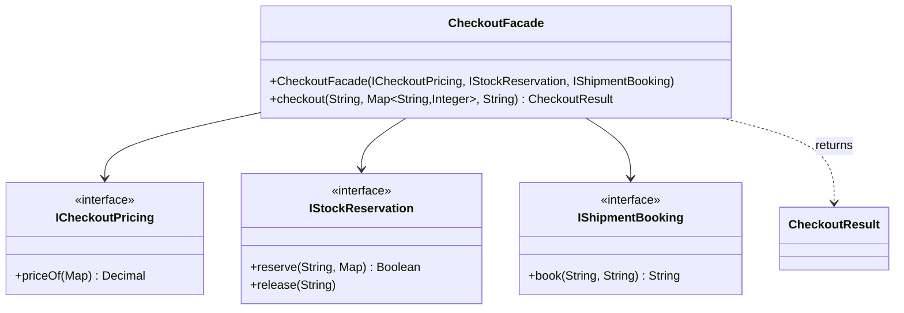

# Facade

**Intent:** give callers one simple entry point to a set of subsystems, hiding the order of the steps and how to undo them.

## The problem here

Checkout needs pricing, a stock reservation and a carrier booking, in that order. If booking fails, the stock must be released. An LWC controller, an invocable action for a Flow and a REST endpoint would each repeat those steps, and one of them would forget the release. `CheckoutFacade.checkout()` is the one place that knows the sequence and the compensation, and it returns a `CheckoutResult` instead of three subsystem answers.

## Shape in Apex



```apex
CheckoutResult result = facade.checkout('ORD-1', new Map<String, Integer>{ 'MUG' => 2 }, 'SW1A 1AA');
if (!result.success) {
  // result.failureReason; any reserved stock has already been released
}
```

Code: [`CheckoutFacade.cls`](classes/CheckoutFacade.cls), [`CheckoutResult.cls`](classes/CheckoutResult.cls), the three subsystem interfaces and [`ShipmentBookingException.cls`](classes/ShipmentBookingException.cls) · Tests: [`CheckoutFacadeTest.cls`](classes/CheckoutFacadeTest.cls)

## Use it when

- Several entry points (LWC, Flow, REST, batch) need the same multi-step operation.
- The steps have an order and a compensation that callers mustn't get wrong.
- You want callers to depend on one stable call while the subsystems change behind it.

## Don't use it when

- **It only forwards one call.** A facade over a single subsystem is an extra hop with nothing to hide.
- **Callers genuinely need the subsystems' detail,** for example a stock screen that shows reservations. Let them use the subsystem directly; a facade is a convenience, not a wall.
- **The steps must be all-or-nothing across systems.** A facade can compensate (release stock after a failed booking), but it isn't a distributed transaction. When the carrier and the org can disagree, you need idempotent retries and a recovery process (see `apex-event-ingestion`).
- **It keeps growing.** A facade with twenty methods is a god class. Split it by use case, or move the logic into a service layer.

## Salesforce specifics

- **This is the Service Layer's job in FFLIB.** A facade at the edge of a module, called by `@AuraEnabled`, `@InvocableMethod` and REST classes, keeps those thin. Each should only translate its inputs and call the facade.
- **Inject the subsystems through the constructor.** The tests stub all three with one hand-written `System.StubProvider` and assert the exact call order, including the `release` after a failed booking.
- **Mind the callout rule.** Apex forbids a callout after uncommitted DML in the same transaction. If the reservation were DML and the booking a real callout, this order (reserve, then book) would fail, so the booking would move to a Queueable that runs after the commit, or the reservation would follow the callout. The in-memory subsystems here sidestep that; a production facade has to choose.
- **Return a result, don't throw, for expected failures** (no stock, carrier refused). Exceptions stay for programming errors, such as a facade built without its subsystems.

## See it at scale

`apex-core-lib`'s [`ServiceFactory`](https://github.com/csquaredaz/apex-core-lib/blob/main/force-app/di/classes/ServiceFactory.cls) resolves services by interface, which is where facades like this live in an FFLIB app: interface-typed, resolved through DI and mocked in tests.

## What the tests prove

| Test                                                    | Proves                                                                       |
| ------------------------------------------------------- | ---------------------------------------------------------------------------- |
| `checkout_allSubsystemsSucceed_pricesReservesThenBooks` | The steps run once each, in order, and the result carries total and tracking |
| `checkout_noStock_neverBooks`                           | Without stock, booking is never called                                       |
| `checkout_bookingFails_releasesTheReservedStock`        | A failed booking releases the stock, and the reason is reported              |
| `checkout_invalidInput_callsNoSubsystem`                | A blank reference or an empty basket fails before any subsystem is called    |
| `constructor_missingSubsystem_rejected`                 | A facade can't be built without all three subsystems                         |
| `checkout_twoHundredOrders_eachCompleted`               | 200 checkouts each complete, with three subsystem calls apiece               |
